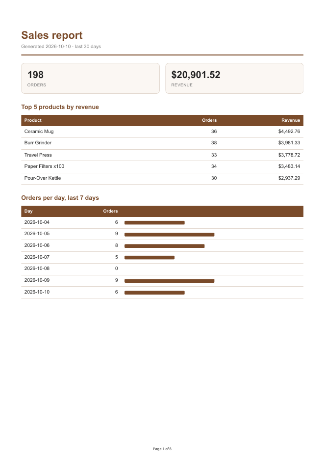

# pdf-report-generator

A small report pipeline behind an API: **SQL query -> HTML template -> PDF (headless Chromium) -> saved on disk -> served by link.** `POST /reports` builds a sales report PDF from a SQLite database, and the client downloads the finished file from `/reports/<id>/file`. The API never passes PDF bytes around in JSON, it stores the file and hands out its address.

JavaScript lane: Node 22.5+ (built-in `node:sqlite`), Express 5, Playwright. No job queue, the whole pipeline runs inside the request (see "Stage 4" below).

**Dataset: Option A, the little shop.** `report.db` has a table `orders` (`id`, `customer`, `product`, `amount`, `created_at`) filled by a seed script with 200 orders over the last 30 days (6 products, amounts 5-200), and a table `reports` that records each generated file.



## Run it

```bash
npm install
npx playwright install chromium     # one-time browser download
npm run seed                        # creates report.db with 200 orders (safe to run twice)
npm start                           # API on http://localhost:3000  (PORT=... to change)
```

Then, from another terminal:

```bash
curl -i -X POST http://localhost:3000/reports                 # 201 + {"id":1,"file":"/reports/1/file",...}
curl -o my-report.pdf http://localhost:3000/reports/1/file    # downloads the PDF
curl http://localhost:3000/reports/1                           # the record
curl http://localhost:3000/reports                             # list of all reports
npm run report-data                                            # print the aggregated numbers as JSON, no server
npm test                                                       # 9 tests (uses real Chromium for one of them)
```

If Playwright's own browser isn't installed but you have a Chromium/Chrome, set `CHROMIUM_PATH=/path/to/chrome`.

### API

| Request | Result |
| --- | --- |
| `GET /health` | `200 {"status":"ok"}` |
| `POST /reports` | `201` + `{id, file, created_at, params}` after generating; `200` + the existing report if one was already made today (Stage 5) |
| `POST /reports {"days":7}` | same, but the totals/top products/table only cover the last 7 days (1-365; anything else is `400`) |
| `POST /reports {"force":true}` | skips the once-per-day check and always makes a new file |
| `GET /reports` | all reports, newest first |
| `GET /reports/:id` | the record, `404` for an unknown id |
| `GET /reports/:id/file` | the PDF (`application/pdf`, downloaded as `sales-report-<date>-<id>.pdf`), `404` if unknown |

`reports/` (the PDFs) and `report.db` are git-ignored; the seed script and the API recreate them.

## The aggregation SQL

All in `src/queries.js` (`getReportData`). `:since` is `0000-01-01` for all time, or `today - (days-1)` when `days` is given.

```sql
-- two totals
SELECT COUNT(*) AS orders, COALESCE(SUM(amount), 0) AS revenue FROM orders WHERE created_at >= :since;

-- top 5 products by revenue
SELECT product, COUNT(*) AS orders, SUM(amount) AS revenue
  FROM orders WHERE created_at >= :since
 GROUP BY product ORDER BY revenue DESC LIMIT 5;

-- orders per day, last 7 days (days with no orders are filled in with 0 in JS)
SELECT created_at AS day, COUNT(*) AS orders
  FROM orders WHERE created_at >= :seven_days_ago
 GROUP BY created_at;

-- the long table at the bottom: every order
SELECT id, customer, product, amount, created_at FROM orders WHERE created_at >= :since
 ORDER BY created_at DESC, id DESC;
```

`test/queries.test.js` recounts the totals and the top 5 by brute force in JS and checks that no product's revenue exceeds total revenue.

## The PDF

`src/render.js` builds one HTML page (title with today's date, two total cards, top-5 table, 7-day table with bars, then all orders) and prints it with `page.pdf({ format: "A4", printBackground: true })`. The classic trap is a long table sliced by a page break, so the CSS has:

```css
thead { display: table-header-group; }  /* header row repeats on every page */
tr    { break-inside: avoid; }          /* a row never splits across pages */
```

Result for the 200 seeded orders: 8 pages (summary, then 7 pages of orders), and the table header is on each of those 7 pages (`pdftotext` finds 7 header rows). A footer shows "Page N of M".

## Proof: POST -> download

```
$ curl -si -X POST localhost:3111/reports
HTTP/1.1 201 Created
{"id":1,"file":"/reports/1/file","created_at":"2026-10-10T19:13:11.438Z","params":{}}

$ curl -sD- -o my-report.pdf localhost:3111/reports/1/file
HTTP/1.1 200 OK
Content-Disposition: attachment; filename=sales-report-2026-10-10-1.pdf
Content-Type: application/pdf

$ pdfinfo my-report.pdf | grep -E "Title|Pages"
Title:           Sales report 2026-10-10
Pages:           8

$ curl -i localhost:3111/reports/999
HTTP/1.1 404 Not Found
{"error":"report not found"}
```

## Stage 4: when would I move this out of the request?

On this laptop the POST takes about 0.4 s for 200 orders (the brief expected a few seconds), so there is no visible pause to feel. I would move the work out of the request once it can take longer than a few seconds or when many users generate at once, because a request that stays open that long times out behind proxies, ties up a worker, and loses the work if the client disconnects. The big-table experiment below shows where that starts.

## Stage 5: ask twice, get one

`POST /reports` returns the existing report instead of making another when one was already generated *today* with the *same options*. That protects against a double-click, a retrying client or two tabs each creating a PDF, which wastes CPU and disk and, in a real system, causes duplicate side effects. Real-world example: a missing check like this on a "send the invoice" or "email the monthly statement" endpoint emails a customer twice, or charges a card twice.

The check has two layers because a double-click is the *second request arriving while the first is still rendering*, before any database row exists to find. So there is also an in-memory map of jobs in flight: the second request awaits the first request's job and gets its id.

Proof, two POSTs fired at the same time against a fresh database (one request got `201` because it created the report, the other `200` because it got the existing one; one file on disk), then `force`:

```
$ (curl -s -X POST localhost:3111/reports -w " [%{http_code}]\n" & curl -s -X POST localhost:3111/reports -w " [%{http_code}]\n" & wait)
{"id":1,"file":"/reports/1/file","created_at":"2026-10-10T19:13:32.518Z","params":{}} [201]
{"id":1,"file":"/reports/1/file","created_at":"2026-10-10T19:13:32.518Z","params":{}} [200]
$ ls reports
sales-report-2026-10-10-1.pdf
$ curl -s -X POST localhost:3111/reports -H 'content-type: application/json' -d '{"force":true}'
{"id":2,...} [201]
$ ls reports
sales-report-2026-10-10-1.pdf  sales-report-2026-10-10-2.pdf
```

Limit: the in-flight map lives in one process. With several server processes behind a load balancer you would need a database-level guard (for example a unique key on day + options, claimed before rendering). The "today" boundary is UTC.

## Extras I added

- **Parameterized report:** `{"days": 7}` narrows the totals, top 5 and detail table; different options count as a different report for the once-per-day rule.
- **Control panel:** `GET /reports` lists everything.
- **Nice filenames and page numbers:** `sales-report-2026-10-10-1.pdf`, footer "Page N of M", brand colours.
- **Big-table experiment:** I seeded 5,000 orders into a scratch database and generated again: the endpoint took **2.1 s** and produced a **153-page, 458 KB** PDF (vs 0.4 s / 8 pages for 200 rows). Time grows roughly with row count, so a report over a few hundred thousand rows would sit inside one HTTP request for minutes. That is the point at which this should become a background job that answers `202` immediately and lets the client poll.

## Not done

I skipped the optional AI rematch stage and the stretch goals (Inngest background job, cron, mailcatcher email); the background-job pattern is covered in a separate assignment.

## Layout

```
src/app.js         Express routes, once-per-day logic, store-and-link
src/queries.js     getReportData(): the aggregation
src/render.js      HTML template + Playwright PDF
src/db.js          schema (orders, reports)
src/seed.js        deterministic seed, wipes first
test/              queries + API tests (node --test)
```
